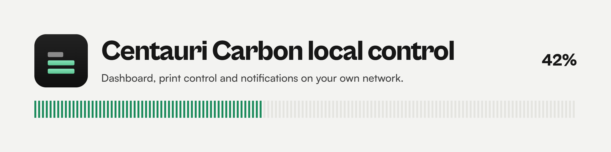

<picture>
  <source media="(prefers-color-scheme: dark)" srcset="docs/assets/banner-dark.png">
  
</picture>

# Elegoo Centauri Carbon local control

[](https://github.com/emmpaul/elegoo-centauri-carbon/actions/workflows/ci.yml)
[](https://github.com/emmpaul/elegoo-centauri-carbon/actions/workflows/ci.yml?query=branch%3Amain)


[](LICENSE)

A small service that talks to an Elegoo Centauri Carbon over its local SDCP
protocol and gives you, on your own network:

- a dashboard for your phone or PC with live status and the camera,
- print control: pause, resume, stop, and the chamber light,
- push notifications through [ntfy](https://ntfy.sh) when a print starts,
  finishes, fails, pauses, or stops, and when the printer goes offline or
  comes back.

Everything runs locally; nothing goes through Elegoo's cloud.

## Quick start

On Linux (or WSL2) with Docker and its compose plugin, paste this block into
a terminal. Change `192.0.2.10` on its first line to your printer's address
first. The block downloads `compose.yaml` and `printer.env.example` into
`~/printer`, writes the printer address and a new access token into
`printer.env`, starts the newest published version, and prints the token:

```sh
printer_ip=192.0.2.10
mkdir -p ~/printer && cd ~/printer
curl -fsSLO https://raw.githubusercontent.com/emmpaul/elegoo-centauri-carbon/main/compose.yaml
curl -fsSLO https://raw.githubusercontent.com/emmpaul/elegoo-centauri-carbon/main/printer.env.example
cp printer.env.example printer.env && chmod 600 printer.env
sed -i "s/^PRINTER_IP=.*/PRINTER_IP=$printer_ip/; s/^ACCESS_TOKEN=.*/ACCESS_TOKEN=$(openssl rand -hex 32)/" printer.env
tag=$(curl -fsSL 'https://api.github.com/repos/emmpaul/elegoo-centauri-carbon/releases?per_page=1' | sed -n 's/.*"tag_name": *"v\([^"]*\)".*/\1/p')
if [ -n "$tag" ]; then
  echo "IMAGE_TAG=$tag" > .env && docker compose up -d
else
  echo "Could not look up the newest release: put IMAGE_TAG=<version> in .env, then run docker compose up -d" >&2
fi
grep ACCESS_TOKEN printer.env
```

Then open <http://127.0.0.1:8080/> and enter the token. Give the printer a
fixed address (a DHCP reservation on your router), since the container can't
find it on its own.

- **Version:** the block picks the newest release. You can also read a
  version from the [Releases](https://github.com/emmpaul/elegoo-centauri-carbon/releases)
  page and set it by hand in `.env` (for example `IMAGE_TAG=1.0.0-rc.5`).
- **Update:** change `IMAGE_TAG` in `.env`, then
  `docker compose pull && docker compose up -d`.
- **macOS:** `sed -i` above is GNU syntax. Edit `PRINTER_IP` and
  `ACCESS_TOKEN` (from `openssl rand -hex 32`) in `printer.env` by hand
  instead.

To run it without Docker, see [Install](#install) and [Run](#run).

### Reach the dashboard

Run the block above first: it writes `.env`, and the lines below add to it.
Run these in `~/printer`.

1. **This machine only** (the default): <http://127.0.0.1:8080/>.
2. **Other devices on your home network:** publish the port on the host's
   LAN address (or `0.0.0.0` for every interface):

   ```sh
   echo PUBLISH_ADDR=<host LAN IP> >> .env && docker compose up -d
   ```

   Open `http://<host LAN IP>:8080/`, and allow port 8080 in the host's
   firewall if it has one. This is fine on a trusted home network because
   the token is required. Don't forward the port on your router.
3. **From anywhere, privately, with [Tailscale](https://tailscale.com):**
   install Tailscale on the host and on your phone, then either publish on
   the host's tailnet address and open `http://<tailnet IP or MagicDNS name>:8080/`:

   ```sh
   echo PUBLISH_ADDR=$(tailscale ip -4) >> .env && docker compose up -d
   ```

   or keep the default and let Tailscale serve it over HTTPS at
   `https://<machine>.<tailnet>.ts.net/` (needs HTTPS turned on for your
   tailnet). With HTTPS, Android also offers to install the dashboard as an
   app. See [Tailscale Serve](https://tailscale.com/kb/1312/serve).

   ```sh
   tailscale serve --bg 8080
   ```

4. **Public HTTPS on your own domain:** put a reverse proxy in front of it
   over a VPN, as in [docs/deployment.md](docs/deployment.md) (Dokploy and
   Tailscale). Never expose port 8080 itself to the internet.

## Requirements

- **Node.js 26 or newer.** The service runs its TypeScript directly with
  Node's built-in type stripping, so there is no build step. With
  [nvm](https://github.com/nvm-sh/nvm), the repository's `.nvmrc` selects it:

  ```sh
  nvm install   # once
  nvm use
  ```

- **pnpm.** Node 26 no longer ships Corepack, so `corepack enable` is not
  available. Install pnpm with its standalone installer (the version matches
  `packageManager` in `package.json`):

  ```sh
  curl -fsSL https://get.pnpm.io/install.sh | env PNPM_VERSION=10.33.0 sh -
  ```

  On Windows PowerShell, use
  `Invoke-WebRequest https://get.pnpm.io/install.ps1 -UseBasicParsing | Invoke-Expression`.
  Open a new shell afterwards (or `source` your shell's rc file) so `pnpm` is
  on your `PATH`, and check it with `pnpm --version`.

- The printer and the machine running the service on the same local network.

## Install

```sh
git clone <this repository> elegoo-centauri-carbon
cd elegoo-centauri-carbon
nvm use
pnpm install
pnpm typecheck
pnpm test
```

## Try it without the printer

`pnpm start:fake` runs the service on `127.0.0.1:8080` against a fake printer
and a fake camera with a print running:

```sh
pnpm start:fake
```

Open <http://127.0.0.1:8080/> in a browser, or from another shell:

```sh
curl -s http://127.0.0.1:8080/api/status
```

Stop it with Ctrl-C. Its options (port, token, simulated failures) are in
[docs/api.md](docs/api.md#trying-it-without-the-printer).

## Configure

Copy the example config and edit it. `config.json` is ignored by git, so your
token and topic stay out of the repository.

```sh
cp config.example.json config.json
```

| Setting | Meaning | Environment override |
| --- | --- | --- |
| `printerIp` | Printer address. `null` finds the printer with UDP discovery. | `PRINTER_IP` |
| `listen.host` | Address the API and dashboard listen on (default `0.0.0.0` = every interface; the example config uses `127.0.0.1`). A non-loopback address requires a token. | `LISTEN_HOST` |
| `listen.port` | Port of the API and dashboard (default `8080`). | `LISTEN_PORT` |
| `token` | Access token for the API and dashboard. `null` means no token check, allowed only on a loopback `listen.host`. | `ACCESS_TOKEN` |
| `ntfy.url` | ntfy server (default `https://ntfy.sh`). | `NTFY_URL` |
| `ntfy.topic` | ntfy topic. `null` turns notifications off. | `NTFY_TOPIC` |
| `events` | Which events notify (`started`, `finished`, `failed`, `paused`, `stopped`, `offline`, `online`). | `NOTIFY_EVENTS` |
| `dataDir` | Directory of the print history archive, relative to the working directory (default `data`). It is created when missing and must be writable. | `DATA_DIR` |

Settings come from built-in defaults, then the config file, then environment
variables, so an environment variable wins. An empty variable counts as unset.
`NOTIFY_EVENTS` is a comma-separated list of the events to turn on (every
other event is off), or `none`. `CONFIG_PATH` reads the config from another
file than `./config.json`.

### Access token

A non-loopback listen address requires a token. The service refuses to start
when `listen.host` is anything other than `127.0.0.1` (or another
`127.x.x.x` address), `localhost`, or `::1` and no token is set, and prints
which setting to change. The example config listens on `127.0.0.1`, so it
starts as copied, but only this machine can open the dashboard. To reach it
from your phone, set a token and `listen.host` (or `LISTEN_HOST`) to
`0.0.0.0`.

Generate a random token with:

```sh
node -e "console.log(crypto.randomBytes(24).toString('hex'))"
```

and put it in `token` (or `ACCESS_TOKEN`). API clients send it as
`Authorization: Bearer <token>` or `?token=<token>`; the dashboard asks for it
once and remembers it. See [docs/api.md](docs/api.md#access-token).

**Upgrading an install that listens on `0.0.0.0` without a token:** it stops
starting, with
`refusing to listen on 0.0.0.0 without an access token: ...`. Set `token` (or
`ACCESS_TOKEN`) and open the dashboard once with `?token=<token>`, or set
`listen.host` (or `LISTEN_HOST`) to `127.0.0.1` if only this machine uses it.

### Notifications

Notifications are off until you set `ntfy.topic`. Choosing a topic, the phone
app, a test notification (`pnpm notify:test`), and self-hosting ntfy are in
[docs/notifications.md](docs/notifications.md).

## Run

```sh
pnpm start
```

It prints the printer address and the port, for example
`printer 192.168.0.96; API on http://0.0.0.0:8080`. Open
`http://<address of this machine>:8080/` on your phone (this needs
`listen.host` `0.0.0.0` and a token, see [Access token](#access-token)). Stop
it with Ctrl-C.

### On a PC (Linux, macOS, Windows)

Follow [Install](#install) and run `pnpm start`. Allow incoming connections on
the port (8080 by default) in the firewall so your phone can reach it.

### On Windows with WSL2

WSL2's default networking puts Linux behind a NAT, which has two effects:

- **Discovery does not work.** The UDP broadcast that finds the printer does
  not cross the NAT, so `printerIp: null` fails with
  `no printer answered UDP discovery; set printerIp in the config`. Set
  `printerIp` (or `PRINTER_IP`) to the printer's address, which you can read
  on the printer's screen or your router.
- **Other devices can't reach the service directly.** Either turn on mirrored
  networking (`networkingMode=mirrored` under `[wsl2]` in
  `%UserProfile%\.wslconfig`, then `wsl --shutdown`), or forward the port from
  Windows with `netsh interface portproxy`. Then allow the port in the Windows
  firewall.

### On a Raspberry Pi

Any Pi that runs a 64-bit Raspberry Pi OS works; the service is light. Install
Node 26 with nvm and pnpm as in [Requirements](#requirements), then follow
[Install](#install) and [Configure](#configure). To keep it running across
reboots, a systemd unit such as `/etc/systemd/system/centauri.service`:

```ini
[Unit]
Description=Centauri Carbon local control
After=network-online.target
Wants=network-online.target

[Service]
User=pi
WorkingDirectory=/home/pi/elegoo-centauri-carbon
ExecStart=/home/pi/.nvm/versions/node/<version>/bin/node src/main.ts
Restart=on-failure

[Install]
WantedBy=multi-user.target
```

Replace `<version>` with the output of `nvm which 26` (use that full path for
`ExecStart`), then `sudo systemctl enable --now centauri`.

### In Docker

Releases publish an image for 64-bit PCs and Raspberry Pis,
`ghcr.io/emmpaul/elegoo-centauri-carbon`. It is configured with the
environment variables from [Configure](#configure), needs `PRINTER_IP` (UDP
discovery does not reach the printer from a container) and `ACCESS_TOKEN`
(it listens on `0.0.0.0` inside the container), and runs as a non-root user
with a health check.

```sh
docker run -d --name printer --restart unless-stopped \
  -p 127.0.0.1:8080:8080 \
  -e PRINTER_IP=192.0.2.10 -e ACCESS_TOKEN=<token> \
  ghcr.io/emmpaul/elegoo-centauri-carbon:<version>
```

`<version>` is a version from the
[Releases](https://github.com/emmpaul/elegoo-centauri-carbon/releases) page
(for example `1.0.0-rc.5`).

Or with the compose file in this repository, which reads `printer.env`, and
`IMAGE_TAG` from the shell or a `.env` file next to it:

```sh
cp printer.env.example printer.env   # set PRINTER_IP, and ACCESS_TOKEN to the output of: openssl rand -hex 32
echo IMAGE_TAG=<version> > .env
docker compose up -d
```

Both publish the port on `127.0.0.1` only; use `-p 8080:8080` (or
`PUBLISH_ADDR=0.0.0.0` with compose) to reach it from other devices. Serving
it over HTTPS on your own domain, with Dokploy and Tailscale, is in
[docs/deployment.md](docs/deployment.md).

### Installing the dashboard as an app

Browsers install a web app only from HTTPS (or `localhost` on the same
machine). Over plain `http://<lan address>`, Safari on iOS can still add it to
the home screen, but Android won't offer to install it. For the install prompt
on Android, serve the dashboard over HTTPS, for example with `tailscale serve`
or a reverse proxy. Details in [docs/api.md](docs/api.md#dashboard).

### Dashboard fonts

The dashboard is designed in Satoshi and Cabinet Grotesk. Their licence, the
[ITF Free Font License](https://www.fontshare.com/licenses/itf-ffl), lets you
self-host your own copy but not redistribute it, so the font files are not in
this repository or in the image. Download them once from Fontshare into
`web/fonts/` (git ignores it):

```sh
pnpm fonts:fetch
```

The service serves them from there, and the page never contacts Fontshare.
Without them the dashboard works the same in the system's fonts. For the
container, mount the fetched folder (see
[docs/deployment.md](docs/deployment.md#dashboard-fonts)):

```sh
docker run -d --name printer --restart unless-stopped \
  -p 127.0.0.1:8080:8080 \
  -e PRINTER_IP=192.0.2.10 -e ACCESS_TOKEN=<token> \
  -v "$PWD/web/fonts:/app/web/fonts:ro" \
  ghcr.io/emmpaul/elegoo-centauri-carbon:<version>
```

## Security

- **Do not expose the service to the internet.** It can pause and stop
  prints and shows your camera, and it is built for a trusted local network,
  not the open internet. Don't forward its
  port on your router. For remote access, use a VPN such as Tailscale or
  WireGuard, or an HTTPS front door reached over one, as in
  [docs/deployment.md](docs/deployment.md).
- **Set a token** (`token` / `ACCESS_TOKEN`) so other devices on your network
  can't pause or stop a print. The service requires one to listen on anything
  but loopback.
- Treat the ntfy topic as a password: anyone who knows it can read your
  notifications. See [docs/notifications.md](docs/notifications.md).

## Documentation

- [docs/api.md](docs/api.md): HTTP API, live events, camera, dashboard, and
  the fake printer (`pnpm start:fake`).
- [docs/notifications.md](docs/notifications.md): ntfy setup and the events
  that notify.
- [docs/deployment.md](docs/deployment.md): the container on a home node,
  HTTPS through Dokploy and Tailscale, upgrades, and the post-deploy checks.
- [docs/sdcp-protocol.md](docs/sdcp-protocol.md): the printer's SDCP protocol
  as this project uses it.
- [ROADMAP.md](ROADMAP.md): planned and possible features, and what each
  needs from the protocol.

## License

[MIT](LICENSE) © 2026 Emmanuel Paul. Not affiliated with or endorsed by Elegoo.
